<div align="center">

# HadeShiki

### C++ Developer • Game Development • Open Source


<br/>


</div>

---

## About Me

```cpp
namespace HadeShiki {
    const char* role = "Game Developer";
    const char* language = "C++";
    const char* os = "Windows 11";

    const char* favorite_1 = "Hatsune Miku";
    const char* favorite_2 = "Ryo Yamada";

    bool open_to_learning = true;
    bool love_creating = true;
}
```

- 🎮 Interested in Game Development
- 💻 Enjoy programming with C++
- 🌱 Always learning something new
- 💙 I love Miku!
- 🎸 I love Ryo!

## My Favorites

<div align="center">

### 💙 I Love Miku


### 🎸 I Love Ryo


</div>

---

## Tech Stack

<div align="center">


</div>

---

## Interests

- Game Development
- C++ Programming
- Open Source Projects
- Software Architecture
- Anime & Manga
- Creative Projects

---

## GitHub Activity

<div align="center">




</div>

---

<div align="center">

**Thanks for visiting my profile!**

*Keep creating. Keep learning. Keep building.*


</div>