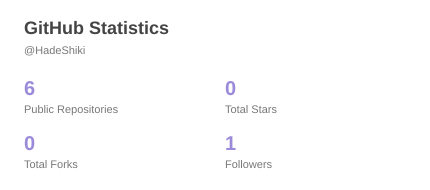
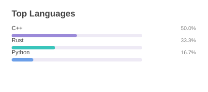

# HadeShiki

### C++ Developer | Game Development | Open Source

 

---

## About Me

- Interested in Game Development
- Enjoy programming with C++
- Always learning something new
- Interested in Open Source Projects
- Love Hatsune Miku
- Love Ryo Yamada

---

## My Favorites

### Hatsune Miku

  

### Ryo Yamada

---

## Tech Stack

<picture>
  <source
    media="(prefers-color-scheme: dark)"
    srcset="https://skillicons.dev/icons?i=cpp,cmake,git,github,vscode,windows&theme=dark"
  />
  
</picture>

---

## Interests

- Game Development
- C++ Programming
- Open Source Projects
- Software Architecture
- Anime and Manga
- Creative Projects

---

## GitHub Statistics

<picture>
  <source
    media="(prefers-color-scheme: dark)"
    srcset="./profile/stats-dark.svg"
  />
  
</picture>

<picture>
  <source
    media="(prefers-color-scheme: dark)"
    srcset="./profile/top-langs-dark.svg"
  />
  
</picture>

---

### Thanks for visiting my profile!

Keep Creating. Keep Learning. Keep Building.

<picture>
  <source
    media="(prefers-color-scheme: dark)"
    srcset="https://capsule-render.vercel.app/api?type=waving&color=0:24243E,50:302B63,100:0F0C29&height=100&section=footer"
  />
  
</picture>

