<div align="center">

  

  <br/>

  

  <br/>

  
  
  

</div>

---

### `whoami`

Hey! I'm **HadeShiki**.

I'm a developer who enjoys building software, experimenting with ideas, and exploring how things work under the hood.

Most of my time goes into C++, development tools, and open-source projects. I like keeping things simple, writing maintainable code, and sharing what I make.

```cpp
namespace hadeshiki {

    constexpr auto language = "C++";
    constexpr auto platform = "Windows 11";
    constexpr auto build = "CMake / Makefile";
    constexpr auto mindset = "Keep it simple";

}
```

### `tech.stack`

<p align="center">
  
</p>

<div align="center">

| Category | Technologies |
|:--|:--|
| Language | C++ |
| Build Systems | CMake · Makefile |
| Environment | Windows 11 |
| Version Control | Git · GitHub |
| Interests | Software Development · Open Source |

</div>

### `open.source`

I believe good software should be shared.

I enjoy creating and publishing open-source projects, learning from other developers, and contributing to tools that people can actually use.

- Building useful software and tools.
- Exploring modern C++ and software design.
- Writing clean and maintainable code.
- Sharing projects with the community.

### `streak`

<div align="center">
  
</div>

### `contributions`

<div align="center">

  

  <br/>

  <picture>
    <source media="(prefers-color-scheme: dark)" srcset="https://raw.githubusercontent.com/HadeShiki/HadeShiki/output/github-snake-dark.svg" />
    <source media="(prefers-color-scheme: light)" srcset="https://raw.githubusercontent.com/HadeShiki/HadeShiki/output/github-snake.svg" />
    
  </picture>

</div>

### `achievements`

<div align="center">

  

</div>

---

<div align="center">

  <a href="https://github.com/HadeShiki">
    
  </a>

  

  <br/><br/>

  <sub>Made with curiosity, coffee, and a little bit of C++.</sub>

  <br/><br/>

  

</div>